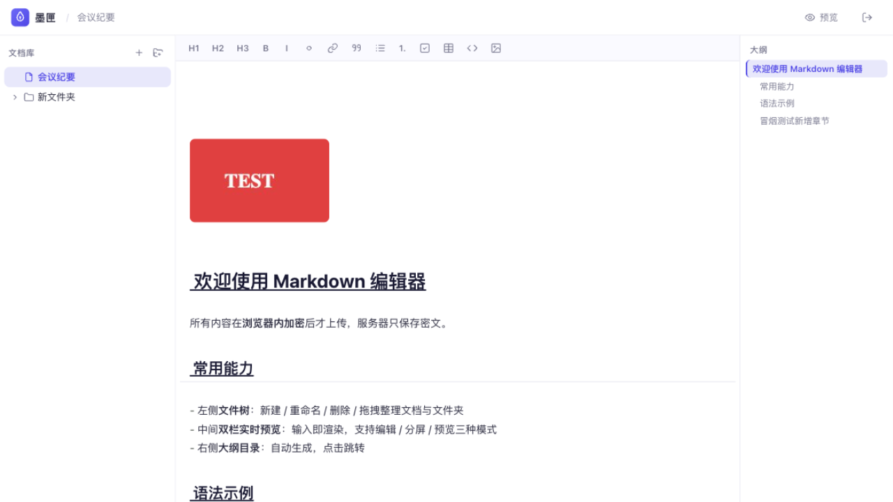

# 墨匣 InkVault

> 落笔即密的 Markdown 笔记。像 Typora 一样写作，像保险柜一样守护。

墨匣是一个部署在自己 Cloudflare 账号上的加密笔记应用：编辑框内实时渲染 Markdown，文件树管理文档，截图粘贴即插入。所有文字与图片在离开浏览器之前就已完成加密，服务器只保存密文——密码只在你手里，谁也读不了你的笔记，包括平台本身。



## 特性

- **所见即所得编辑**：基于 CodeMirror 6 语法树装饰，标题/加粗/斜体/代码/引用/链接/任务列表在编辑框内直接渲染；**光标行同样保持渲染**，仅当光标紧贴语法标记（如 `#`、`**`）时该标记才临时显示源码，块级元素（代码块围栏、整行图片、任务列表）仍按光标所在行显示源码以便编辑
- **两种视图**：编辑（所见即所得，默认）与预览（纯阅读），顶栏一键切换
- **图片支持**：粘贴截图 / 拖拽图片文件 / 工具栏按钮三种插入方式；客户端自动压缩（最长边 1600px、JPEG 82%，SVG/GIF 原样保留，原图上限 8MB）后加密存储，编辑框与预览中直接显示（`` 引用，同样端到端加密）
- **文件树**：文件夹/文档层级，新建、行内重命名、删除（带确认）、拖拽移动与排序
- **大纲目录（TOC）**：从源码实时提取标题，点击跳转（编辑模式定位到源码行，预览模式滚动到锚点），随滚动高亮
- **端到端加密（E2EE）**：密码在浏览器经 PBKDF2（310k 迭代）派生 AES-256-GCM 密钥，标题、内容与图片加密后才上传；服务器（D1）只存密文，拖库也读不到内容
- **自动保存**：停顿 1.5 秒自动加密上传；多设备并发编辑用版本号乐观锁检测冲突
- **登录防护**：登录凭证与服务端存储分离（双 salt），失败 5 次锁定 15 分钟，会话 7 天滑动过期
- **安全渲染**：markdown-it 关闭内嵌 HTML（`html: false`）+ 链接协议白名单（http/https/mailto/asset），杜绝 XSS

## 技术栈

React 18 + TypeScript + Vite · CodeMirror 6 · markdown-it + highlight.js · zustand · Hono · Cloudflare Workers + D1（`@cloudflare/vite-plugin` 本地与线上同运行时）

## 本地开发

```bash
npm install
npx wrangler d1 migrations apply markdown-editor --local   # 初始化本地 D1
npm run dev                                                 # http://localhost:5173
```

## 部署（与仓库分离，手动执行）

```bash
# 1. 登录 Cloudflare（浏览器授权）
npx wrangler login

# 2. 创建 D1 数据库，把返回的 database_id 填入 wrangler.jsonc
npx wrangler d1 create markdown-editor

# 3. 执行线上数据库迁移（含文档表与图片附件表）
npx wrangler d1 migrations apply markdown-editor --remote

# 4. 部署（Worker 名为 inkvault）
npm run deploy
```

部署完成后打开 Workers 分配的域名，首次访问设置强密码即可使用。

## 安全须知

- **密码无法找回**：加密密钥由密码派生且永不离开浏览器，忘记密码 = 数据永久无法解密
- 加密密钥仅存于页面内存，刷新后需重新输密码解锁
- 服务端可见的仅有：会话哈希、文档树层级结构（不含名称与内容）、密文与时间戳

## 目录结构

```
src/
├── worker/index.ts      # Hono API：认证、会话、文档/图片密文 CRUD（乐观锁 + 递归删除）
├── lib/
│   ├── crypto.ts        # PBKDF2 派生 + AES-256-GCM 加解密（WebCrypto）
│   ├── livePreview.ts   # CodeMirror 即时渲染装饰插件（含块级图片 widget）
│   ├── assets.ts        # 图片压缩、加密上传、按需解密成 blob URL（带缓存）
│   ├── markdown.ts      # markdown-it 渲染 + 源码大纲提取
│   └── api.ts           # fetch 封装（自动携带会话）
├── store/app.ts         # zustand：认证流程、文档树、自动保存调度
└── components/          # AuthScreen / FileTree / EditorPane / Preview(+TocPanel) / Icons
migrations/              # D1 表结构（0001 初始 + 0002 图片附件）
```
