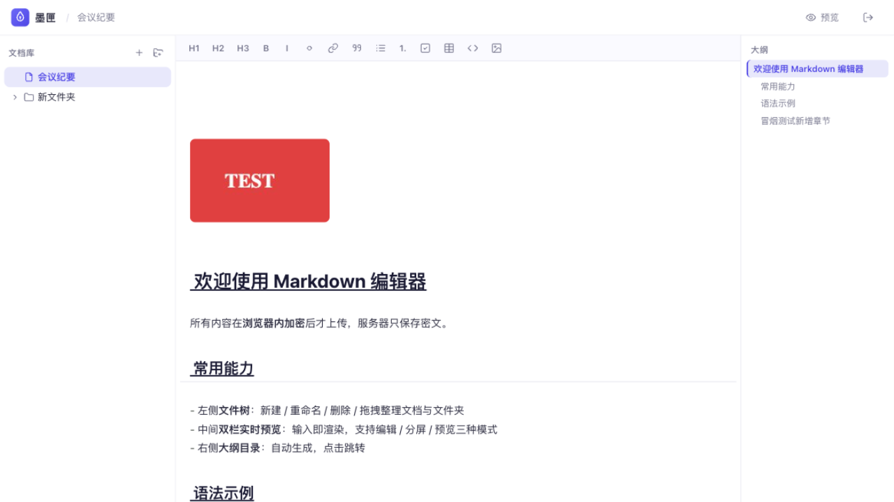

# 墨匣 InkVault

Markdown 笔记应用，部署在 Cloudflare Workers 上。文字和图片在浏览器里加密后才上传，服务器（D1 数据库）只存密文；密码只在浏览器里派生密钥，不经过服务器，所以忘记密码数据就无法恢复。



## 功能

- 编辑框内直接渲染 Markdown（所见即所得）：标题、加粗、代码块、引用、表格、任务列表即写即显。光标行也保持渲染，只有光标贴着 `#`、`**` 这类标记时才显示源码。顶栏可切换纯预览阅读
- Mermaid 流程图：编辑框与预览中直接渲染，光标进入时显示源码
- 文字颜色与背景高亮：工具栏色板或 `Cmd/Ctrl+Shift+H` 快速高亮（HTML 白名单消毒，仅放行颜色样式）
- 全库搜索：`Cmd/Ctrl+Shift+F` 跨全部文档搜内容，点击结果跳到对应文档与行
- 文档历史：编辑自动留快照（每文档保留最近 60 版，10 分钟节流），可看全文 / 行级变更对比 / 一键恢复；快照同样端到端加密存 D1
- 插入图片：粘贴截图、拖拽文件或工具栏按钮。图片先压缩（最长边 1600px、JPEG 82%，SVG/GIF 原样保留，原图限 8MB）再加密上传，编辑框和预览里直接显示；双击图片全屏查看（滚轮缩放、双击 1x↔2.5x、Esc 关闭）
- 快捷键：标题/列表 `Cmd/Ctrl+Shift+1~9`、行内代码 `Cmd/Ctrl+E`、插入时间 `Cmd/Ctrl+;` 等
- 文件树：文件夹/文档层级，新建（可选目录与命名）、重命名、删除（自绘确认框）、拖拽排序
- 大纲：随内容实时更新，点击跳转，随滚动高亮
- 自动保存：停顿 1.5 秒后加密上传，多设备编辑有版本冲突检测
- 登录防护：密码错误 5 次锁定 15 分钟，会话 7 天有效

服务端能看到的信息只有：会话哈希、文档树的层级结构（不含名称和内容）、密文、时间戳、历史快照的行数统计。

## 技术栈

React 18 + TypeScript + Vite，CodeMirror 6，markdown-it + highlight.js，zustand，Hono，Cloudflare Workers + D1。本地开发用 `@cloudflare/vite-plugin`，与线上同一运行时。

## 本地开发

```bash
npm install
npx wrangler d1 migrations apply markdown-editor --local
npm run dev   # http://localhost:5173
```

## 部署

```bash
npx wrangler login
npx wrangler d1 create markdown-editor   # 把返回的 database_id 填入 wrangler.jsonc
npx wrangler d1 migrations apply markdown-editor --remote
npm run deploy
```

打开 Workers 分配的域名，首次访问设置密码即可使用。

## 目录结构

```
src/
├── worker/       # Hono API：认证、会话、文档与图片的密文 CRUD
├── lib/          # 加密（WebCrypto）、即时渲染插件、图片处理、markdown 渲染、请求封装
├── store/        # zustand：认证流程、文档树、自动保存
└── components/   # 登录、文件树、编辑器、预览与大纲、图标
migrations/       # D1 表结构
```
